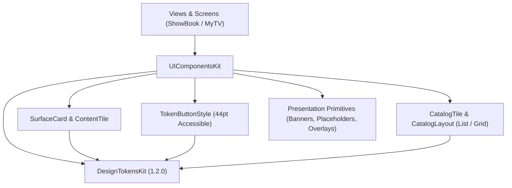

# UIComponentsKit

A suite of composable, accessible SwiftUI surfaces, catalog items, and interactive button primitives. Built on top of `DesignTokensKit`.


---

## Architecture



`UIComponentsKit` provides production-ready UI components designed around pure composability:

1. **Decoupled Caller Ownership**:
   - The package contains **no app models, network requests, persistence, or localized string catalogs**.
   - Callers retain ownership of image loading, data bindings, action closures, and navigation.
2. **Accessible Interaction & Geometry**:
   - `TokenButtonStyle`: Implements native `ButtonStyle` with minimum 44pt touch targets adhering to Human Interface Guidelines.
   - `CatalogLayout`: Supports dynamic switching between `.list` and `.grid` layouts, with automatic fallback to list presentation under Dynamic Type accessibility sizes.
3. **Presentation Primitives**:
   - `StateMessage`: Empty, error, and informational state banners with iconography and action slots.
   - `IconMessageBanner`: Edge-to-edge message banner with semantic color styling.
   - `FieldPlaceholder`: Non-destructive placeholder layout overlay that prevents layout jumps.
   - `CenteredProgressOverlay`: Centered loading spinner backdrop.
4. **Strict Concurrency Compliance**:
   - Built with `-strict-concurrency=complete`. All component metrics and models conform to `Sendable`.

---

## Use Cases

- **Catalog & Feed Construction**: Display media items, books, or video cards with `CatalogTile`, switching smoothly between list rows and grid tiles.
- **Empty & Error State Views**: Provide standardized state messages (`StateMessage`) with actionable buttons for empty search results or network failures.
- **Form & Input Polish**: Enhance text fields with non-destructive floating placeholders (`FieldPlaceholder`) and standardized action buttons.
- **Custom Themed Cards**: Encapsulate elevated or bordered content containers with `SurfaceCard`.

---

## Practical Code Examples

### 1. CatalogTile with Dynamic List/Grid Layout

```swift
import SwiftUI
import DesignTokensKit
import UIComponentsKit

struct MediaCatalogView: View {
    @State private var layout: CatalogLayout = .grid
    @Environment(\.dynamicTypeSize) private var dynamicTypeSize

    var body: some View {
        VStack {
            HStack {
                Text("Library")
                    .font(.title2.bold())
                Spacer()
                CatalogLayoutMenu(selection: layout) { newLayout in
                    layout = newLayout
                } onGridUnavailable: {
                    print("Grid layout unavailable at this accessibility size")
                }
            }
            .padding()

            ScrollView {
                CatalogTile(
                    layout: layout.resolved(isAccessibilitySize: dynamicTypeSize.isAccessibilitySize),
                    artwork: {
                        Image(systemName: "tv.fill")
                            .resizable()
                            .aspectRatio(contentMode: .fit)
                            .frame(width: 80, height: 80)
                    },
                    details: {
                        Text("Cosmos")
                            .font(.headline)
                        Text("Science & Nature")
                            .font(.caption)
                            .foregroundColor(.secondary)
                    },
                    actions: {
                        Button(action: {}) {
                            Image(systemName: "heart")
                        }
                    }
                )
            }
        }
    }
}
```

### 2. StateMessage for Empty Search Results

```swift
import SwiftUI
import DesignTokensKit
import UIComponentsKit

struct EmptySearchView: View {
    var onReset: () -> Void

    var body: some View {
        StateMessage(
            icon: "magnifyingglass",
            title: "No Results Found",
            message: "We couldn't find any titles matching your query. Try searching for a different keyword.",
            actionTitle: "Clear Search",
            onAction: onReset
        )
        .padding()
    }
}
```

### 3. SurfaceCard with Custom Metrics

```swift
import SwiftUI
import DesignTokensKit
import UIComponentsKit

struct FeaturedCard: View {
    var body: some View {
        SurfaceCard(
            metrics: SurfaceMetrics(
                padding: EdgeInsets(top: 16, leading: 16, bottom: 16, trailing: 16),
                cornerRadius: CornerRadius.sixteen,
                borderWidth: StrokeWidth.one
            ),
            colors: SemanticColors(
                surface: Color(.secondarySystemBackground),
                border: Color(.separator)
            )
        ) {
            VStack(alignment: .leading, spacing: Spacing.eight) {
                Text("Editor's Choice")
                    .font(.caption.bold())
                    .foregroundColor(.blue)
                Text("Building Scalable Swift Packages")
                    .font(.headline)
            }
        }
    }
}
```

### 4. Accessible Button Styling

```swift
import SwiftUI
import DesignTokensKit
import UIComponentsKit

struct ConfirmButton: View {
    var action: () -> Void

    var body: some View {
        Button("Confirm Order", action: action)
            .buttonStyle(TokenButtonStyle(
                metrics: ButtonMetrics(cornerRadius: CornerRadius.twenty),
                colors: SemanticColors(action: .blue, onAction: .white)
            ))
    }
}
```

---

## Release Version Controlling

`UIComponentsKit` adheres strictly to [Semantic Versioning (SemVer 2.0.0)](https://semver.org/spec/v2.0.0.html):

| Release Level | Criteria | Example Tag |
| :--- | :--- | :--- |
| **MAJOR** (`X.0.0`) | Breaking changes to component signatures, layout contracts | `v2.0.0` |
| **MINOR** (`1.X.0`) | New components, additional layout options, presentation primitives | `v1.2.0` |
| **PATCH** (`1.2.X`) | Bug fixes, rendering parity adjustments, styling fixes | `v1.2.1` |

- **Release Documentation**: Documented in [CHANGELOG.md](CHANGELOG.md).
- **Tag Validation**: Release tags follow `vX.Y.Z` and are validated using `bash Scripts/verify-release-version.sh`.
- **SPM Integration**:
  ```swift
  .package(url: "https://github.com/Anurag-Chourasia/UIComponentsKit.git", exact: "1.2.0")
  ```

---

## Quality & CI Verification

Every pull request and merge to `main` must pass all CI checks before merging:

1. **SwiftLint Gate**:
   - Pinned SwiftLint 0.65.1 enforcement (`.swiftlint.yml`).
   - Zero-warning strict mode (`--strict`).
   - Run locally: `bash Scripts/lint.sh`.
2. **Build, Test & Interaction Gate**:
   - Host target compilation and unit test execution with complete strict concurrency (`-strict-concurrency=complete`) and `-warnings-as-errors`.
   - iOS Simulator product verification via `xcodebuild`.
   - Native iOS UI interaction test suite (`Validation/run-interactions.sh`).
