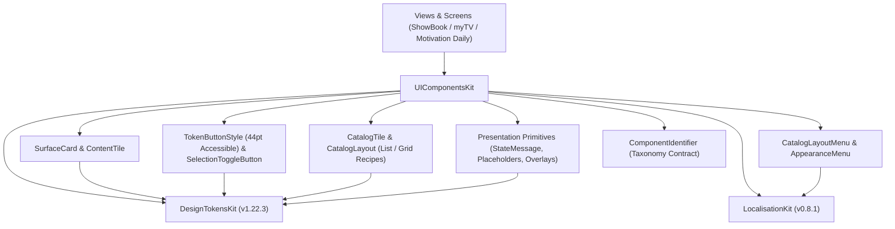
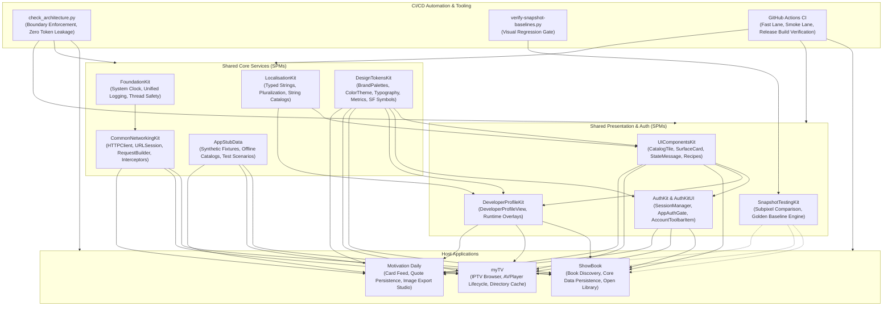

# UIComponentsKit

A suite of composable, accessible SwiftUI surfaces, catalog items, layout recipes, and interactive button primitives built on top of `DesignTokensKit`.


---

## 1. Executive Summary & Purpose

`UIComponentsKit` provides modular, production-ready UI components for multi-app architectures (**ShowBook**, **myTV**, and **Motivation Daily**). It decouples presentation primitives from domain business logic, network transports, and specific image loading pipelines.

### Key Engineering Objectives:
- **Decoupled Caller Ownership**: Components contain zero app models, network requests, persistence dependencies, or hardcoded strings. Callers retain ownership of image loading, data bindings, action closures, and navigation.
- **Accessible Interaction & Geometry**: Buttons enforce minimum 44pt touch targets (`TouchTarget.minimum`). Catalogs automatically adapt between grid and list layouts based on Dynamic Type accessibility sizes.
- **Catalog Layout Recipes**: Houses shared catalog geometry rules, such as `CatalogTileMetrics.compactGridRecipe(accessibility:)`, ensuring consistent grid proportions across applications.
- **Architectural Boundary Enforcement**: Bundles and maintains `Scripts/check_architecture.py`, which validates lexical boundaries, tokenization compliance, and ComponentIdentifier usage across all 12 modules in the portfolio.

---

## 2. Architecture & Design Principles



---

## 3. Dependency Graph & Consumer Matrix

| Direction | Package / Project | Responsibility |
|---|---|---|
| **Upstream Dependencies** | **DesignTokensKit** (`v1.22.3`) | Spacing, CornerRadius, TouchTarget, and SemanticColors. |
| | **LocalisationKit** (`v0.8.1`) | Reusable UI label strings (e.g. Menu titles, default actions). |
| **Downstream Consumers** | **AuthKitUI** | Consumes `TokenButtonStyle`, `StateMessage`, and `SurfaceCard`. |
| | **DeveloperProfileKit** | Consumes `SurfaceCard`, `IconMessageBanner`, and button styles. |
| | **ShowBook** | Book items, catalog grid/list view, search state messages, and layout menus. |
| | **myTV** | Channel tiles, stream selection lists, appearance menus, and error banners. |
| | **Motivation Daily** | Category card presentation, state overlays, and appearance dialogs. |

---

## 4. Reusable Control Governance & Decisions (IOS-62, IOS-67)

To prevent premature abstraction while maximizing code reuse, components across the portfolio are governed by explicit classification:

### 1. Catalog Layout Recipes (IOS-62)
- `CatalogTileMetrics.compactGridRecipe(accessibility:)`: Standardized preset recipe (`120x120` standard, `160x170` accessibility) with `CornerRadius.twenty`.
- `CatalogLayout.resolved(isAccessibilitySize:)`: Automatically adapts grid presentations to list presentation under Dynamic Type accessibility environments.

### 2. Component Taxonomy Decisions (IOS-67)
- **SideActionIconView** (*Motivation Daily*): **Keep Local**. Strongly bound to `MotivationStrings`, quote viewer gesture handling, and photo export overlay lifecycle.
- **BookCoverPreview & BookItem** (*ShowBook*): **Keep Local**. Domain-specific Core Data models and book metadata belong in the host application; container layout is provided by `CatalogTile` and `SurfaceCard`.
- **ChannelLogo & StreamRow** (*myTV*): **Keep Local**. Encapsulates AVPlayer stream playback URLs, IPTV transport states, and aspect-ratio constraints.
- **CatalogLayoutMenu & AppearanceMenu**: **Shared in UIComponentsKit**. Uniformly adopted across all three host applications.
- **SelectionToggleButton & CenteredProgressOverlay**: **Shared in UIComponentsKit**. Reusable interactive selection and modal loading indicators.

---

## 5. API Contracts & Practical Code Examples

### 1. CatalogTile with Compact Grid Recipe
```swift
import SwiftUI
import UIComponentsKit

struct MediaCatalogGrid: View {
    @Environment(\.sizeCategory) var sizeCategory
    let items: [MediaItem]

    var body: some View {
        let isAccessibility = sizeCategory.isAccessibilityCategory
        let metrics = CatalogTileMetrics.compactGridRecipe(accessibility: isAccessibility)

        LazyVGrid(columns: [GridItem(.adaptive(minimum: metrics.width))]) {
            ForEach(items) { item in
                CatalogTile(
                    title: item.title,
                    subtitle: item.author,
                    metrics: metrics,
                    imageContent: {
                        AsyncImage(url: item.artworkURL)
                    }
                )
            }
        }
    }
}
```

### 2. Standardized StateMessage for Empty or Error Views
```swift
import SwiftUI
import UIComponentsKit

struct EmptySearchView: View {
    let query: String
    let onReset: () -> Void

    var body: some View {
        StateMessage(
            icon: .search,
            title: "No Results Found",
            message: "We couldn't find any items matching '\(query)'. Please try another search.",
            actionTitle: "Clear Search",
            action: onReset
        )
    }
}
```

### 3. Accessible Button Styling
```swift
import SwiftUI
import UIComponentsKit

struct ActionButtons: View {
    var body: some View {
        Button("Save Preferences") {
            // Commit changes
        }
        .buttonStyle(TokenButtonStyle(variant: .primary))
    }
}
```

---

## 6. Architecture Validator Tooling (`check_architecture.py`)

`UIComponentsKit` maintains the automated portfolio-wide architectural boundary scanner: `Scripts/check_architecture.py`.

```sh
# Run boundary check across all 12 modules
python3 Scripts/check_architecture.py --workspace-root /path/to/Projects
```

### Validated Rules:
1. **Zero Raw Symbols**: Presentation code must consume `DesignSystemSymbol` or designated constants instead of raw `systemName:` strings.
2. **Zero Inline Color Literals**: Prevents hardcoded hex/RGB `Color(...)` or `UIColor(...)` literals.
3. **Domain Layer Independence**: Prohibits UI imports (`SwiftUI`, `UIKit`, `AppKit`) inside `Domain/` or `Core/` directories.
4. **ComponentIdentifier Integrity**: Enforces registered namespace taxonomy for component telemetry and test identification.

---

## 7. Verification & Testing

```sh
# Run Swift package tests locally
swift test

# Run SwiftLint strictly
swiftlint lint --strict
```

---

## 8. End-to-End Ecosystem Connectivity



---

## 9. Canonical Notion Dashboards & Governance Links

- [iOS Portfolio — Engineering Tickets Dashboard](https://app.notion.com/p/c20d7f4b133b44499c8ac0b4d5f6249e?pvs=204)
- [iOS Portfolio — Master Document](https://app.notion.com/p/40ffa5f855b98192ad2ede66a5d36fe7)
- [Architecture Boundary Validator (`check_architecture.py`)](file:///Users/anuragchourasia/Desktop/Projects/UIComponentsKit/Scripts/check_architecture.py)
- [Release & Gate Policy Documentation (`Docs/MASTER.md`)](file:///Users/anuragchourasia/Desktop/Projects/Docs/MASTER.md)
